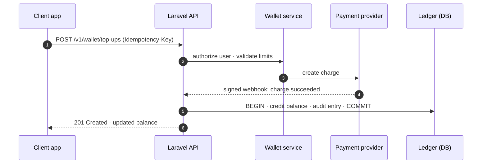

# Easy Pay

**Digital wallet and payments product**: user balances, secure transaction handling and multiple payment providers behind one interface.

> **Showcase repository.** The production source code is private. This repository documents the product, its architecture and the engineering decisions behind it. Details and a walkthrough are available on request: mohammed.r.almekhafi@gmail.com

## Payment flow (simplified)

## Engineering highlights

- Provider-agnostic gateway layer: one contract, one driver per payment provider.
- Every balance change runs inside a database transaction and writes an audit entry.
- Provider webhooks are signature-verified and processed asynchronously through queues.
- Role-based access control for customer, merchant and back-office operations.

## Stack

`Laravel` · `PHP` · `MySQL` · `Queues` · `Webhooks` · `RBAC`
